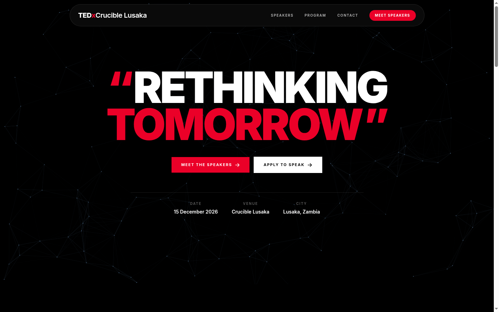

# TEDx Crucible Lusaka



<p align="center">
  Official website for <strong>TEDx Crucible Lusaka</strong>, built with React 19, Vite, Tailwind CSS v4, and Framer Motion.
</p>

<p align="center">
  
  
  
  
  
</p>

## Live Site

https://tedxcruciblelusaka.netlify.app/

## About

The site is the digital home of TEDx Crucible Lusaka, an independently organised TEDx event at Crucible Lusaka in Lusaka, Zambia.

- **Theme:** Rethinking Tomorrow
- **Event date:** 15 December 2026
- **Venue:** Crucible Lusaka, Lusaka, Zambia

The experience is a single-page React app with four views:

- **Home** — hero, event details, and editorial sections about the event and its theme.
- **Speakers** — the guest speaker and student speaker line-up.
- **Contact** — direct email contact and a message form that opens a pre-filled email draft.
- **Apply to speak** — a multi-step speaker application form.

## Features

- Floating, responsive pill navigation with a compact mobile menu.
- Editorial home page with a restrained black-and-white layout and brand red accents.
- WebGL hero particle field with a blue network and red connections that follow the cursor.
- Ambient particle backdrop and a blue smoke treatment on the Speakers page.
- Reduced-motion support: decorative animation is disabled when the visitor prefers reduced motion.
- Speakers overview and a four-step speaker application form.
- Contact page with copy-to-clipboard email and a `mailto:` draft form.
- Static, fast deployment with Vite.

## Tech Stack

| Technology | Purpose |
| --- | --- |
| React 19 | UI and view state |
| Vite 8 | Development server and production build |
| Tailwind CSS 4 | Styling and design tokens |
| Framer Motion | View transitions and reveal animations |
| WebGL / Canvas | Hero and ambient particle effects |
| Web3Forms | Speaker application delivery |

## Getting Started

### Prerequisites

- Node.js 20.19+ or 22.12+
- npm

### Clone and install

```bash
git clone https://github.com/joel-musonda/TEDx-crucible-Lusaka-website.git
cd TEDx-crucible-Lusaka-website
npm install
```

### Environment variables

The speaker application form uses Web3Forms. Create a `.env` file in the project root:

```env
VITE_WEB3FORMS_ACCESS_KEY=your_access_key_here
```

Get a free access key from [Web3Forms](https://web3forms.com/). The Contact page does not need a backend key; it opens the visitor's email app with a pre-filled message.

### Run locally

```bash
npm run dev
```

Open http://localhost:5173.

### Production build

```bash
npm run build
npm run preview
```

The production output is written to `dist/`.

## Project Structure

```text
src/
├── assets/                 # Logos, event photos, README preview
├── components/
│   ├── Navbar.jsx          # Floating pill navigation
│   ├── Hero.jsx            # Homepage hero and particle field
│   ├── MainContent.jsx     # Homepage editorial sections
│   ├── SpeakersPage.jsx    # Speaker line-up
│   ├── ContactPage.jsx     # Contact details and mailto form
│   ├── SpeakerForm.jsx     # Multi-step speaker application
│   ├── Footer.jsx
│   ├── background.tsx      # WebGL particle network
│   ├── Particles.tsx       # Canvas particle system
│   ├── HomeAmbient.jsx     # Ambient homepage backdrop
│   ├── BlueSmoke.jsx       # Speakers page smoke effect
│   └── ui/                 # Globe and footer illustration components
├── hooks/
│   └── useMediaQuery.js
├── App.jsx                 # View switching and page composition
├── main.jsx
├── index.css               # Tailwind import, theme tokens, effect styles
└── theme.js                # Shared brand and particle colours
```

## Deployment

The site deploys as a static Vite build, currently via Netlify.

- Build command: `npm run build`
- Publish directory: `dist`
- Environment variable: `VITE_WEB3FORMS_ACCESS_KEY`

Connect the repository to Netlify for automatic deployments, or upload the `dist/` folder manually.

## Brand Notes

- Brand red: `#EB0028`
- Hover red: `#D00024`
- Use the `ted-red` Tailwind utility in JSX and import `BRAND_RED` / `BRAND_RED_HOVER` from `src/theme.js` for canvas and inline styles. Avoid introducing other red hex values.

## Contributing

1. Fork the repository.
2. Create a branch: `git checkout -b feature/your-feature`.
3. Make and test your changes.
4. Push the branch and open a pull request.

## Maintainer

**Joel Musonda**

- GitHub: https://github.com/joel-musonda

## Acknowledgements

- [TEDx](https://www.ted.com/about/programs-initiatives/tedx-program)
- [React](https://react.dev/)
- [Vite](https://vite.dev/)
- [Tailwind CSS](https://tailwindcss.com/)
- [Framer Motion](https://motion.dev/)
- [Web3Forms](https://web3forms.com/)
- [Netlify](https://www.netlify.com/)

---

This is an independent TEDx event operated under a licence from TED.
